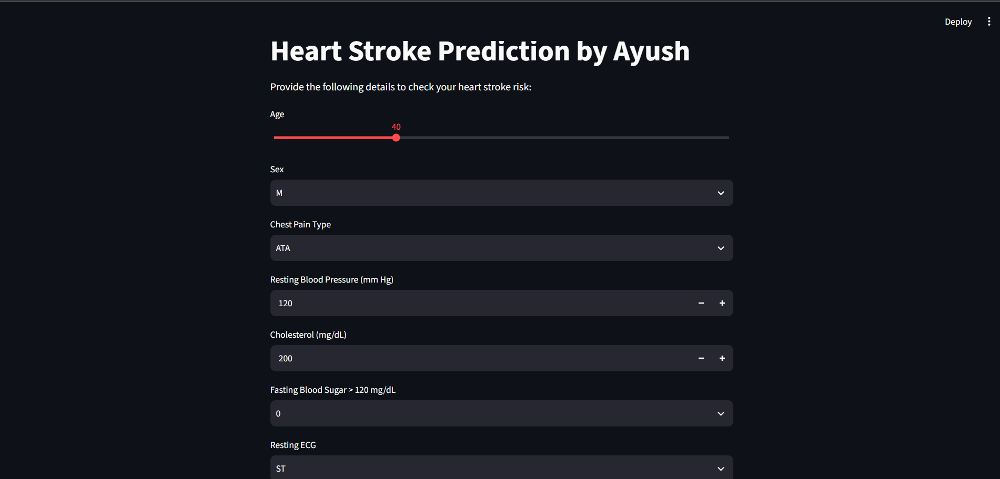
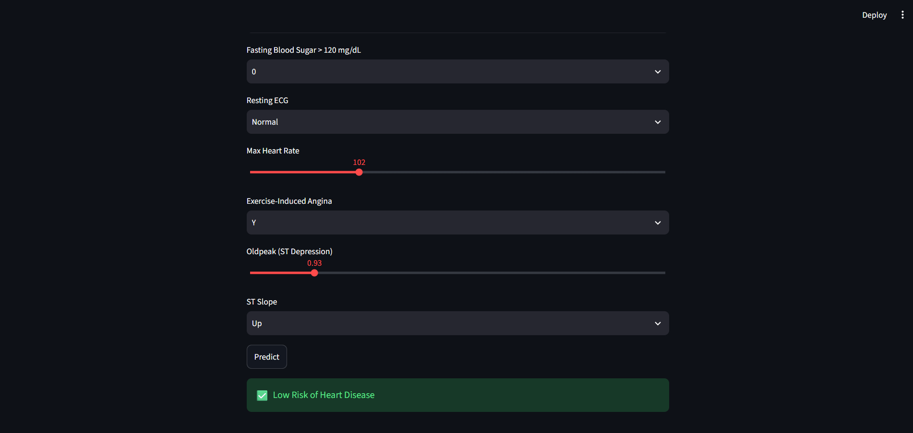
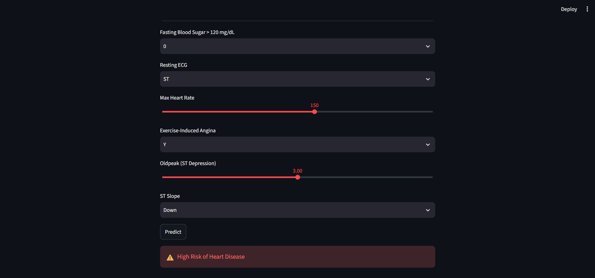

# ❤️ Heart Disease Risk Prediction


A machine learning web app that predicts whether a person has a **high or low risk of heart disease** from basic clinical details. Several classifiers were compared in a Jupyter notebook, and the **K-Nearest Neighbors (KNN)** model is served through an interactive **Streamlit** interface.

---

## 📸 Demo

<p align="center">
  
</p>

| Low Risk Prediction | High Risk Prediction |
|:---:|:---:|
|  |  |

---

## ✨ Features

- Clean, interactive form built with Streamlit (sliders, dropdowns and number inputs)
- Instant prediction with a clear **Low Risk / High Risk** result
- Input scaling and column alignment handled by saved preprocessing artifacts, so predictions match the training pipeline
- Full model-building and comparison workflow documented in a Jupyter notebook

---

## 🧾 Input Features

| Feature | Description | Input type |
|---|---|---|
| Age | Age of the patient in years | Slider (18–100) |
| Sex | Biological sex | `M` / `F` |
| Chest Pain Type | Type of chest pain | `ATA`, `NAP`, `ASY`, `TA` |
| Resting Blood Pressure | Resting BP in mm Hg | Number |
| Cholesterol | Serum cholesterol in mg/dL | Number |
| Fasting Blood Sugar | Fasting blood sugar > 120 mg/dL | `0` / `1` |
| Resting ECG | Resting electrocardiogram result | `Normal`, `ST`, `LVH` |
| Max Heart Rate | Maximum heart rate achieved | Slider |
| Exercise-Induced Angina | Angina triggered by exercise | `Y` / `N` |
| Oldpeak | ST depression induced by exercise | Slider |
| ST Slope | Slope of the peak exercise ST segment | `Up`, `Flat`, `Down` |

---

## 🛠️ Tech Stack

- **Language:** Python 3.11
- **Data analysis:** Pandas, NumPy
- **Visualization:** Matplotlib, Seaborn
- **Machine learning:** scikit-learn (KNN, Logistic Regression, Naive Bayes, SVM, Decision Tree, StandardScaler)
- **Model persistence:** Joblib
- **Web app:** Streamlit

---

## 📁 Project Structure

```
heart-disease-prediction-streamlit/
├── screenshots/          # Images used in this README
│   ├── app-form.png
│   ├── low-risk.png
│   └── high-risk.png
├── app.py                # Streamlit web application
├── heart.ipynb           # Data analysis, model training and comparison
├── heart.csv             # Dataset
├── KNN_heart.pkl         # Trained KNN model
├── scaler.pkl            # Fitted scaler used for input scaling
├── columns.pkl           # Expected feature columns after encoding
├── requirements.txt      # Python dependencies
├── .gitignore
└── README.md
```

---

## ⚙️ How It Works

1. **Data preparation:** the dataset is cleaned and categorical features are one-hot encoded.
2. **Scaling:** numerical features are standardized with a scaler fitted on the training data.
3. **Model training:** several classifiers are trained and compared in `heart.ipynb`, and KNN is saved for the app.
4. **Saving artifacts:** the model, scaler and column list are saved as `.pkl` files.
5. **Prediction:** `app.py` collects user input, encodes it, aligns it to the saved columns, scales it and runs the model to show the result.

---

## 📊 Model Performance

Five classifiers were trained on the scaled data and compared on a held-out test set:

| Model | Accuracy | F1-score |
|---|---:|---:|
| Logistic Regression | 85.87% | 87.38% |
| **K-Nearest Neighbors (deployed)** | **85.33%** | **87.08%** |
| Naive Bayes | 84.78% | 86.14% |
| SVM | 84.78% | 86.79% |
| Decision Tree | 80.98% | 83.09% |

The app uses the **KNN** model. Logistic Regression scored slightly higher, by about half a percentage point, so the two models perform very similarly on this dataset.

---

## 🚀 Getting Started

### Prerequisites

- Python 3.11 (recommended)
- Git

### Installation

```bash
# 1. Clone the repository
git clone https://github.com/Ayush-prajapati79/heart-disease-prediction-streamlit.git
cd heart-disease-prediction-streamlit

# 2. Create and activate a virtual environment
python -m venv venv

# Windows (PowerShell)
venv\Scripts\Activate.ps1
# macOS / Linux
# source venv/bin/activate

# 3. Install dependencies
python -m pip install -r requirements.txt
```

### Run the App

```bash
python -m streamlit run app.py
```

The app opens at **http://localhost:8501**.

### Run the Notebook (optional)

```bash
python -m pip install notebook
python -m jupyter notebook
```

Open `heart.ipynb` and choose **Kernel → Restart & Run All**. This regenerates the `.pkl` files.

---

## ⚠️ Important Notes

- The `.pkl` files are tied to the scikit-learn version they were created with. Install the versions in `requirements.txt` to load them correctly.
- **Disclaimer:** this project is for **educational purposes only**. It is not a medical device and must not be used for diagnosis or treatment decisions. Always consult a qualified healthcare professional.

---

## 🔮 Future Improvements

- Tune hyperparameters with `GridSearchCV` and use cross-validation
- Try ensemble models such as Random Forest and XGBoost
- Show prediction probability alongside the label
- Deploy the app on Streamlit Community Cloud

---

## 👤 Author

**Ayush Prajapati**

- GitHub: [@Ayush-prajapati79](https://github.com/Ayush-prajapati79)

---

⭐ If you found this project useful, consider giving it a star!
